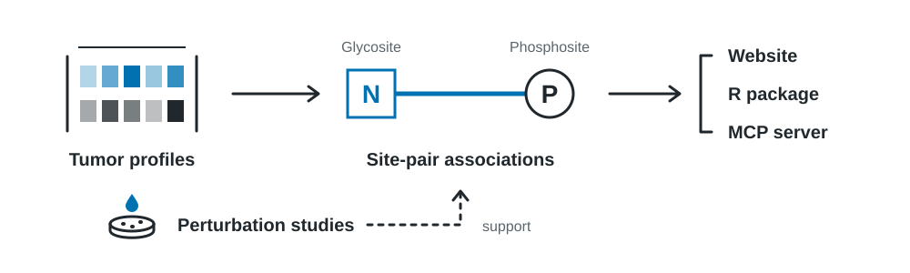

<p align="center">
  
</p>

<h1 align="center">PTMlink</h1>

<p align="center">
  <b>Co-variation of glycosylation and phosphorylation in human tumors</b>
</p>

<p align="center">
  
  
  
  
  <a href="LICENSE"></a>
  
</p>

<p align="center">
  <a href="#r-package">R package</a> &nbsp;·&nbsp;
  <a href="#mcp-server">MCP server</a> &nbsp;·&nbsp;
  <a href="#functions-and-tools">Functions and tools</a> &nbsp;·&nbsp;
  <a href="#reading-a-result">Reading a result</a> &nbsp;·&nbsp;
  <a href="#citation-and-license">Citation</a>
</p>

---

PTMlink is a database of pairs of one N-glycosylation site and one phosphorylation site that co-vary across
CPTAC tumor cohorts. Each pair carries its pooled evidence, its estimate in every cohort, annotations for shared
protein abundance and tissue composition, and evidence from studies that perturbed N-glycosylation in human cells.

This repository holds the two programmatic readers of the database. Both query the same data as the
[PTMlink website](https://ptmlink.biomarkercenter.org/).

<p align="center">
  
</p>

Tumor co-variation sets the ranking; perturbation support is annotated separately.

| Reader | Use it to |
|---|---|
| **`ptmlink` R package** | Retrieve ranked pairs as data frames, plot cohort estimates, build networks and test gene or site lists. |
| **MCP server** | Let an AI assistant query PTMlink through typed tools. MCP, the Model Context Protocol, is an open standard for connecting assistants to tools. |

## Before you start

The readers need the **PTMlink data**, which this repository does not contain. By default they read it from the
website, `https://ptmlink.biomarkercenter.org/data`: each file is downloaded once, checked against the site's
checksum list and cached on your computer (R: `tools::R_user_dir("ptmlink", "cache")`; Python: `~/.cache/ptmlink`,
or the folder named by `PTMLINK_CACHE_DIR`). A local copy of the data directory (the one containing `build.json`,
`SHA256SUMS.json` and `genes/`) works the same way: `ptm_set_data_dir()` in R, `--data-dir` in Python.

## R package

Requires **R 4.5 or later**. Install once, then load and ask:

```r
install.packages("remotes")
remotes::install_github("Effram360/PTMlink", subdir = "ptmlink")
library(ptmlink)

ptm_status("EGFR")                          # how the symbol resolves and what was measured
partners <- ptm_gene("EGFR", "glyco")       # partners of EGFR's glycosites, ranked by evidence
pair <- ptm_pair("IL6ST_N131", "TMX1_S270") # one pair with each cohort's estimate
ptm_explain("IL6ST_N131", "TMX1_S270")      # the cautions that apply to that pair
```

Results print as a short summary; the object keeps every column:

```
> ptm_pair("IL6ST_N131", "TMX1_S270")
IL6ST_N131 x TMX1_S270
  pair id               PTMG:P40189:N131|PTMP:Q9H3N1:S270
  pooled rho            0.23, 95% CI [0.14, 0.31]
  evidence              5.9, q = 1.0e-04
  cohorts               7, 469 tumors; I2 = 0.15
  perturbation          tunicamycin dose response
  parent proteins       rho -0.09
  own-protein coupling  0.42
  adjusted 95% CI       [0.09, 0.28] (an annotation; never used to rank)

  cohort   rho         95% CI  tumors
  BRCA    0.38  [-0.01, 0.67]      27
  ccRCC   0.10  [-0.11, 0.30]      91
  ...

  cautions:      ptm_explain("IL6ST_N131", "TMX1_S270")
  glycoforms:    x$glycoforms
  cohort table:  x$cohorts
  all columns:   x$row
```

`View(partners)` opens the full table in RStudio, `as.data.frame(partners)` gives every column, `ptm_columns()`
defines them, and `?ptm_gene` opens a function's help (press `q` to close it). To plot a pair's cohort estimates:

```r
source(system.file("examples", "inspect_pair.R", package = "ptmlink"))
plot_pair_cohorts(pair)
```

The [R walkthrough](ptmlink/vignettes/ptmlink.Rmd) covers filters, networks and whole-release queries.

## Python command line

Requires **Python 3.9 or later**; per-gene queries use only the standard library.

```bash
git clone https://github.com/Effram360/PTMlink.git
cd PTMlink
python3 python/ptmlink.py status EGFR
python3 python/ptmlink.py gene EGFR --side glyco
python3 python/ptmlink.py pair IL6ST_N131 TMX1_S270
python3 python/ptmlink.py explain IL6ST_N131 TMX1_S270
python3 python/ptmlink.py --json pair IL6ST_N131 TMX1_S270     # the full result as JSON
```

## MCP server

MCP, the Model Context Protocol, lets an AI assistant query PTMlink in plain language. The server gives the
assistant the same functions as the R package, and every answer carries the rules for reading it: a correlation has
no direction, perturbation support never raises a rank, and the cautions that apply to each pair. Each answer is a
short readable summary followed by the result as JSON.

**Claude Code.** From the cloned repository:

```bash
claude mcp add ptmlink -- python3 "$PWD/python/ptmlink_mcp.py"
```

Then ask, for example, "Which phosphosites co-vary with the glycosites of EGFR, and which of them have perturbation
support?" Type `/mcp` to see the server and its tools.

**Other clients** that accept an `mcpServers` configuration use this entry, with the path to this repository:

```json
{
  "mcpServers": {
    "ptmlink": {
      "command": "python3",
      "args": ["/absolute/path/to/PTMlink/python/ptmlink_mcp.py"]
    }
  }
}
```

<details>
<summary><b>Try the tools in a browser (MCP Inspector)</b></summary>

<br>

Requires **Node.js 22.19 or later with npm**.

```bash
npx @modelcontextprotocol/inspector@2.11.0 --web python3 python/ptmlink_mcp.py
```

Open the URL the Inspector prints and keep the terminal running. On **Servers**, turn on the switch beside
**python3**, then select **Tools**. Select `ptm_pair`, enter `"IL6ST_N131"` for `glyco_site` and `"TMX1_S270"` for
`phospho_site` (keep the quotation marks: these fields take JSON), then click **Execute Tool**. Over SSH, forward
port 6274 to your computer first.

</details>

## Functions and tools

The R functions and the MCP tools share names.

| Task | R function | MCP tool |
|---|---|---|
| Check how a symbol resolves and what was measured | `ptm_status` | `ptm_status` |
| Ranked partners of a gene's glycosites or phosphosites | `ptm_gene` | `ptm_gene` |
| Partners of one or more sites | `ptm_site` | `ptm_site` |
| Reported sites of a protein, with their modeled positions | `ptm_sites` | `ptm_sites` |
| One pair with its estimate in every cohort | `ptm_pair` | `ptm_pair` |
| The interpretation rules that apply to a pair | `ptm_explain` | `ptm_explain` |
| The one-hop network around a gene | `ptm_network`, `ptm_plot_network`, `ptm_igraph` | `ptm_network` |
| Test a list of genes or sites against the database ¹ | `ptm_list` | `ptm_list` |
| Every reported pair that meets typed conditions ¹ | `ptm_query` | `ptm_query` |
| Release, cohorts, glycans, columns and citation | `ptm_release`, `ptm_cohorts`, `ptm_glycans`, `ptm_columns`, `ptm_cite` | same names |

¹ Needs the Parquet release; see *Whole-release queries* below.

## Reading a result

- **Ranking.** Pairs are ordered by total evidence, the −log10 P of the estimate pooled across cohorts. The default view shows pairs
  between two different proteins that are significant at q < 0.05 and measured in at least two cohorts.
- **Direction.** A correlation is symmetric. It does not show which modification affects the other.
- **Perturbation evidence.** It can add a pair to the reported pairs. It never raises a pair's rank.
- **Annotations.** The columns adjusted for tissue composition, conditioned on parent-protein abundance, or
  measuring a site's coupling to its own protein are annotations. They never sort results and carry no
  false-discovery rate.
- **Coverage.** Pair responses in R and MCP contain tumor cohorts. Normal tissue and comparisons of one cohort
  against the others are on the website. An absent pair reflects what was measured, not biological absence.
- **Whole-release queries.** `ptm_query` and `ptm_list` also need the Parquet release, which becomes available
  when the article is published, plus `arrow` in R or `pyarrow` in Python. Point to it with
  `ptm_set_release_dir()` or the server's `--release-dir` option.
- **Troubleshooting.** With a local copy, check that the path is the directory containing `build.json`, not its
  parent. If a gene or pair is absent, `ptm_status` reports what was measured for it.

## Repository contents

| Path | Contents |
|---|---|
| `ptmlink/` | The R package: functions, help pages, the walkthrough and the examples |
| `python/ptmlink.py` | The Python query engine behind the MCP server |
| `python/ptmlink_mcp.py` | The MCP server |
| `tests/serve/` | Reader tests that run without the database |

## Citation and license

If you use PTMlink, cite the preprint, [doi:10.64898/2026.11.23.768710](https://doi.org/10.64898/2026.11.23.768710), and name the data
release you used. [CITATION.cff](CITATION.cff) holds the reference, and GitHub's **Cite this repository** button
formats it. Code is [MIT licensed](LICENSE); PTMlink data are licensed CC BY 4.0, subject to the terms of
the source data. This repository contains the readers for release **1.0.0**, released 2026-11-24.
